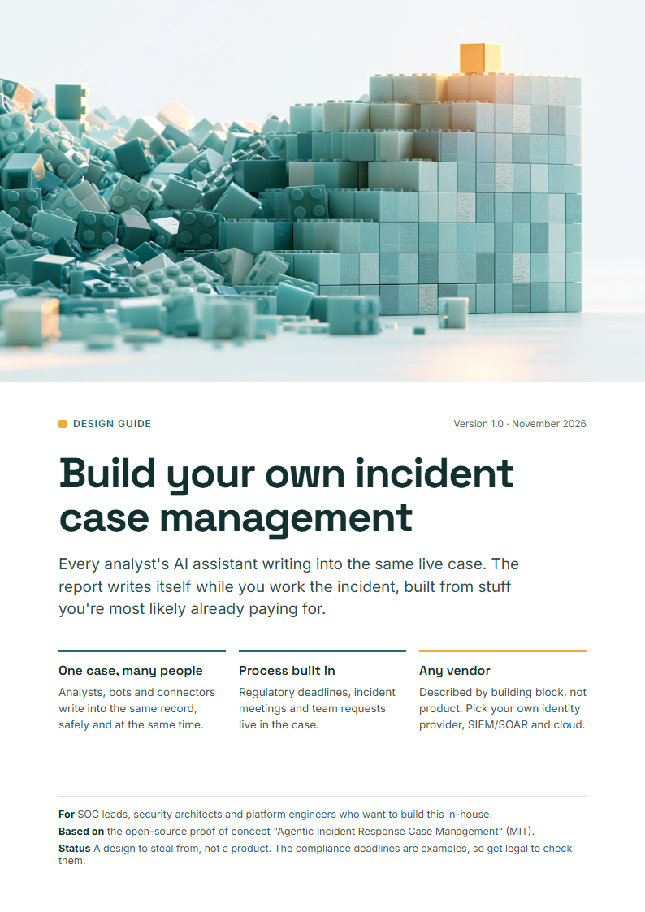
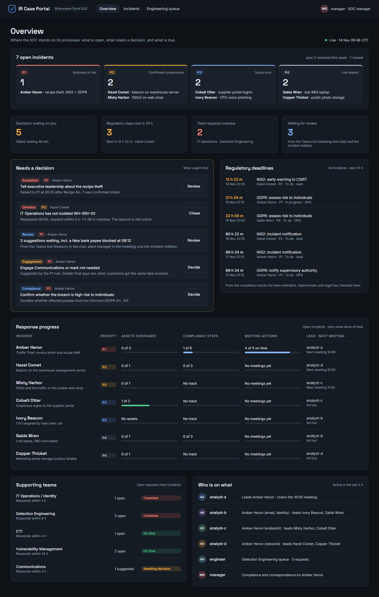
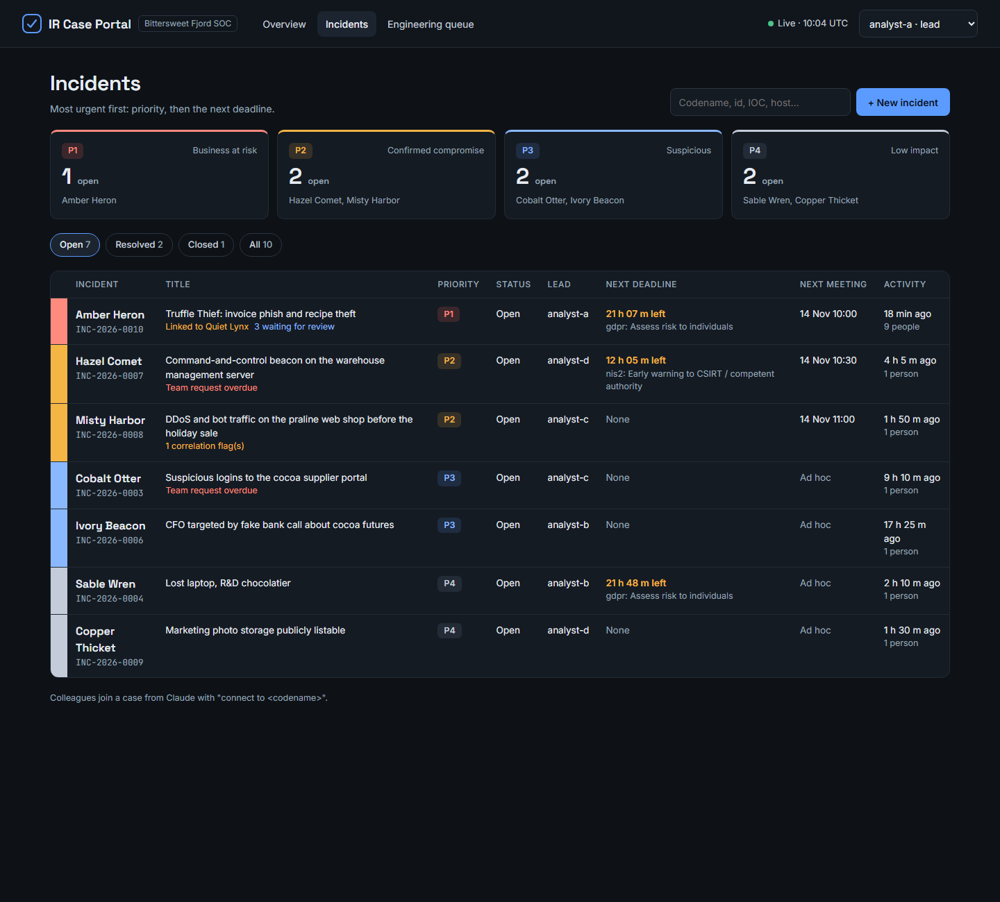
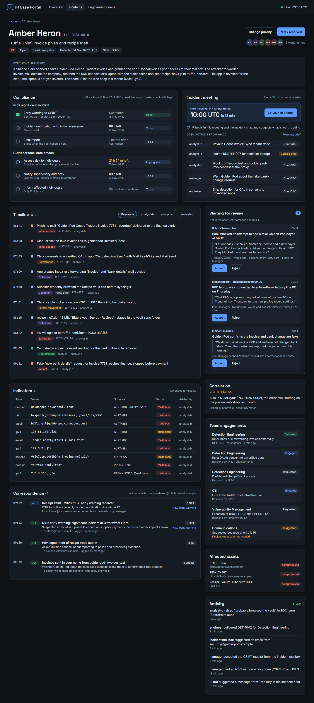
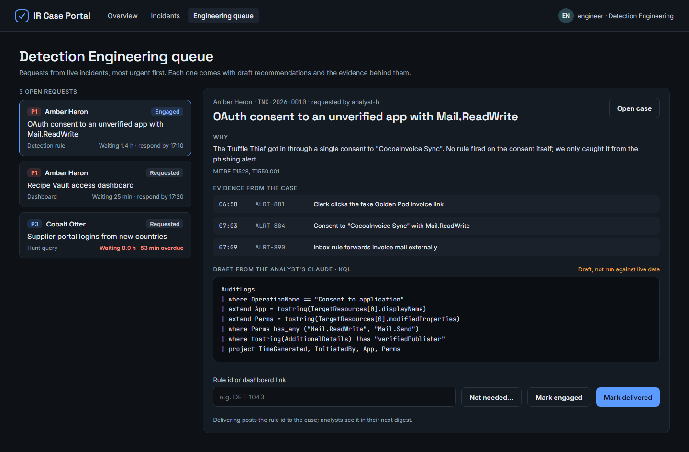
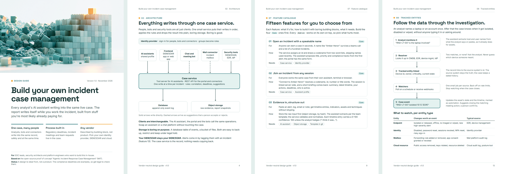

# Agentic Incident Response Case Management (POC)

<p align="center"></p>

One of the most overlooked bottlenecks in a SOC is incident management. It's mostly manual, run by
senior people who know the organisation's processes and how to lead an incident. Big incidents run for
days, across teams and dozens of alerts, and most of us still manage them in ticket comments, chat
threads and an Excel sheet. Vendors would rather ship another chatbot.

So this is a proof of concept where **every analyst's Claude writes into the same live case**. Alerts,
IOCs, timelines, compliance deadlines and who's doing what all land in one place, and the report writes
itself while you work the incident.

You want this because:

1. Incident processes are costly and difficult.
2. Effective remediation comes from strong collaboration.
3. The current status quo is awful.

> Excuse the code and frontend quality. It was made with Claude and some wine. It's a POC: no
> authentication, local storage only, and the compliance deadlines are examples that your legal team
> must check. All demo data is fictional.

## What it does

- **One case per incident**, with a name you can say: *Amber Heron*
- **Everyone writes to it** from their own Claude session
- **Paste anything**, get a timeline, IOCs and assets
- **Compliance deadlines built in**: NIS2, GDPR, DORA
- **Incident meetings** with one owner per action
- **Engineers get rule drafts** straight from the evidence
- **Managers just ask** "what's going on?"
- **Bots and mailboxes suggest**, a human accepts

## The portal (design)

The screens below are the designed frontend, filled with the demo data. The React build is next; in a
real organisation you would build these as a custom app in your SIEM/SOAR or as a static web app.

| Overview for management | Incident list |
| --- | --- |
|  |  |
| **Case page** | **Engineering queue** |
|  |  |

## Build your own: the design guide

Want something like this in your own organisation? The design guide describes it by building block, not
by product, so you can map it to whatever identity provider, SIEM/SOAR and cloud you already pay for.

**[Download the design guide (PDF, 16 pages)](docs/build-your-own-ir-case-management.pdf)**



What's in it: architecture, the building blocks you most likely already own, a reference deployment, the
case service and its event log, syncing AI assistant profiles through your identity provider and internal
git, a catalogue of 15 features (what each is for and how to build it), tracked entities, security, and a
four-phase roll-out.

## Try it

You need Node 24+ and Claude Code. On Windows PowerShell with scripts disabled, use `npm.cmd` instead of
`npm`.

```sh
git clone https://github.com/0xMishee/Agentic-Incident-Response-Case-Management-POC.git
cd Agentic-Incident-Response-Case-Management-POC/incident-mcp
npm install
npm run demo:seed -- --reset   # 10 fictional incidents: a chocolate maker and a recipe thief
npm run demo:start             # case server on http://127.0.0.1:7400, clock set to the demo morning
```

In Claude Code, add the profile from your clone and install it:

```
/plugin marketplace add <path to your clone>
/plugin install soc-ir-profile@agentic-ir
```

Set your name and role when asked, start a new session, and try:

- "Connect to Amber Heron" · "What's going on?" · "Anything new?"
- `/incident meeting brief` · `/incident queue`
- Paste a file from `demo/alerts/` and say "add this"
- "Open an incident for this alert: …" to start your own

**Several people on one machine:** open a terminal per persona with
`demo\personas\persona.cmd analyst-b analyst` (or `demo/personas/persona.sh` on macOS/Linux).

More in [`demo/README.md`](demo/README.md): the story, which file each persona pastes, and a video
script. [`demo/sample-report.md`](demo/sample-report.md) shows what a finished case file looks like.

To run without demo data, use `npm start` instead; it starts with an empty `data/` folder.

## Repository layout

| Path | What |
| --- | --- |
| `incident-mcp/` | Case server (TypeScript, Node 24, `node:sqlite`): event log, MCP tools, REST API, report renderer, tests |
| `profile/` | Claude Code plugin every SOC member installs: connection, skills, `/incident`, session hook |
| `config/` | What a SOC changes: report template, compliance tracks, supporting teams, codename word lists |
| `demo/` | Fictional scenario: alerts, persona launchers, sample report |
| `docs/` | Feature spec, the design guide PDF, images |

```sh
cd incident-mcp && npm test    # acceptance tests
```

## License

MIT. Fork it, rename it, make it yours.
